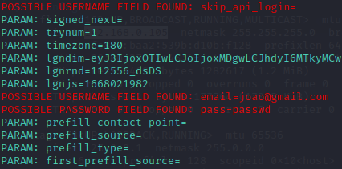

# 🎣 Phishing com SET (Social-Engineering Toolkit) — Captura de Credenciais

> Projeto educacional do desafio de **Cibersegurança** da [DIO](https://www.dio.me/).
> Demonstra, em **ambiente de laboratório controlado**, como funciona um ataque de
> *phishing* por engenharia social usando o **setoolkit** no **Kali Linux** — com o
> objetivo de **entender o vetor de ataque para saber defender-se dele**.

---

## ⚠️ Aviso Legal e Ético (leia antes de tudo)

Este material tem finalidade **exclusivamente educacional e defensiva**.

- Todos os testes foram executados em **ambiente isolado de laboratório** (máquinas
  virtuais e rede própria), **sem nenhuma vítima real**.
- Clonar sites, enganar pessoas e capturar credenciais de terceiros no mundo real é
  **crime**. No Brasil, isso é enquadrado na **Lei nº 12.737/2012** (invasão de
  dispositivo informático) e viola a **LGPD (Lei nº 13.709/2018)**.
- Use este conhecimento **apenas** para proteger sistemas, treinar equipes e conduzir
  testes **autorizados por escrito** (pentest).

> 🔒 Conhecer o ataque é o primeiro passo para construir a defesa.

---

## 🎯 Objetivo

Reproduzir, de forma documentada, um ataque de **Credential Harvesting** (coleta de
credenciais) que:

1. Clona a página de login do Facebook.
2. Hospeda a página falsa em um servidor local.
3. Captura o que a "vítima" digita (usuário e senha) quando acessa o clone.

O foco é **entender cada etapa** e, ao final, discutir **como se proteger**.

---

## 🧰 Ferramentas e Ambiente

| Item | Descrição |
|------|-----------|
| **SO** | Kali Linux (máquina atacante) |
| **Ferramenta** | SET — *Social-Engineering Toolkit* (`setoolkit`) |
| **Rede** | Laboratório isolado / host-only entre VMs |
| **Vítima** | Uma segunda VM (ou o próprio host de teste) na mesma rede |

### Pré-requisitos

- Kali Linux atualizado (`sudo apt update && sudo apt upgrade`).
- `setoolkit` instalado (vem por padrão no Kali; se faltar: `sudo apt install set`).
- Ambiente de rede fechado, sem acesso a usuários reais.

---

## 🪜 Passo a passo

> Todos os comandos foram executados na máquina atacante (Kali Linux).

### 1. Acessar como root
```bash
sudo su
```
*Por quê:* o SET precisa subir um servidor web em porta privilegiada (80), o que exige
privilégios de administrador.

### 2. Iniciar o SET
```bash
setoolkit
```

### 3. Escolher o tipo de ataque
```
1) Social-Engineering Attacks
```
*Por quê:* phishing explora a **confiança do usuário**, não uma falha técnica do alvo.
É um ataque de engenharia social.

### 4. Escolher o vetor de ataque
```
2) Website Attack Vectors
```
*Por quê:* o ataque será entregue por meio de uma **página web** falsa.

### 5. Escolher o método
```
3) Credential Harvester Attack Method
```
*Por quê:* queremos **coletar credenciais** digitadas no formulário de login.

### 6. Escolher a forma de criar a página
```
2) Site Cloner
```
*Por quê:* em vez de criar a página do zero, o SET **clona** uma página real,
deixando o clone visualmente idêntico ao original.

### 7. Descobrir o IP da máquina atacante
Em outro terminal:
```bash
ifconfig
# ou
ip addr
```
Esse IP é onde a página falsa ficará hospedada. Ele é informado ao SET como o endereço
que receberá os dados capturados (o campo *IP address for the POST back*).

### 8. Informar a URL a ser clonada
```
https://www.facebook.com
```
O SET baixa a página de login do Facebook e a replica no servidor local.

### 9. Executar
A vítima (em laboratório) acessa `http://<IP_DO_KALI>` no navegador, vê uma página
idêntica à do Facebook e, ao tentar logar, tem os dados capturados pelo SET — que
normalmente redireciona para o site verdadeiro em seguida, para não levantar suspeita.

---

## 📊 Resultado

Ao submeter o formulário na página clonada, o SET exibe no terminal os campos
capturados. Note os destaques:

- `POSSIBLE USERNAME FIELD FOUND: email=...`
- `POSSIBLE PASSWORD FIELD FOUND: pass=...`



Na imagem é possível ver o SET interceptando o `email` e o `pass` enviados pelo
formulário, além de diversos parâmetros auxiliares que a página original envia. Isso
demonstra, na prática, por que **digitar senha em sites não confiáveis é tão perigoso**:
qualquer página que imite a original consegue capturar tudo que for digitado.

---

## 🛡️ Como se defender (a parte que mais importa)

Entender o ataque serve para construir a defesa. Boas práticas contra phishing:

- **Verifique sempre a URL** na barra de endereço e o **cadeado/HTTPS** (e o certificado).
  Um clone costuma rodar em HTTP e/ou num domínio/IP estranho.
- **Ative a autenticação em dois fatores (2FA/MFA)** — mesmo que a senha vaze, o
  atacante não entra sem o segundo fator.
- **Use um gerenciador de senhas**: ele não preenche credenciais em domínios falsos,
  o que funciona como alerta.
- **Desconfie de links** recebidos por e-mail/mensagem; acesse o serviço digitando a
  URL manualmente ou pelo favorito.
- **Treinamento e conscientização** (*security awareness*) nas empresas.
- **Nunca reutilize senhas** entre serviços diferentes.

---

## 📁 Estrutura do repositório

```
.
├── README.md          # Documentação do projeto
└── images/
    └── passwd.png     # Evidência da captura de credenciais no SET
```

---

## 📚 Referências

- [SET — Social-Engineering Toolkit (TrustedSec)](https://github.com/trustedsec/social-engineer-toolkit)
- [Documentação do Kali Linux](https://www.kali.org/docs/)
- [Repositório base do desafio (DIO)](https://github.com/cassiano-dio/cibersecurity-desafio-phishing)
- [Lei nº 12.737/2012](http://www.planalto.gov.br/ccivil_03/_ato2011-2014/2012/lei/l12737.htm) · [LGPD](http://www.planalto.gov.br/ccivil_03/_ato2015-2018/2018/lei/l13709.htm)

---

## 👤 Autor

**Gtvnv** — [github.com/Gtvnv](https://github.com/Gtvnv)

Projeto desenvolvido como parte do bootcamp de **Cibersegurança** da **DIO**, por um
profissional com formação em **Segurança da Informação**. Todos os testes foram
conduzidos em **ambiente de sandbox isolado**, sem qualquer alvo real.
